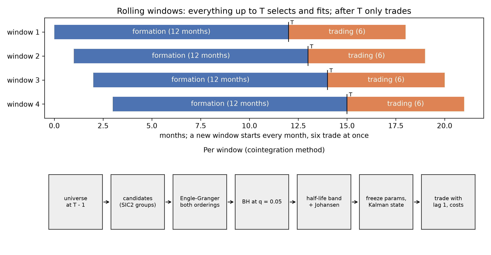
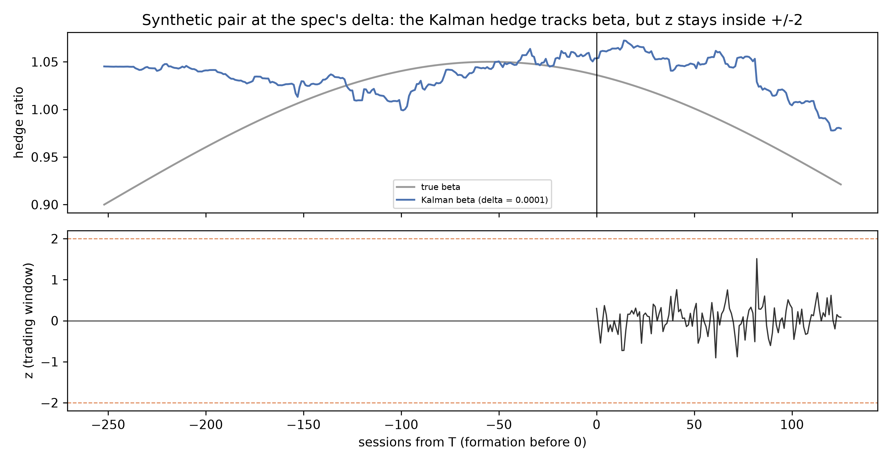
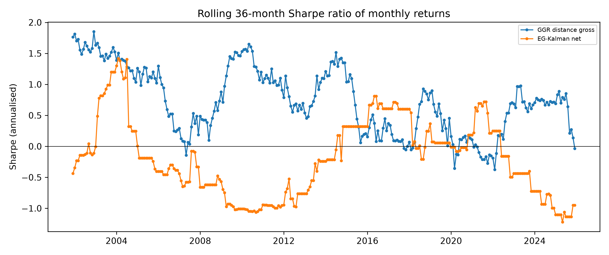
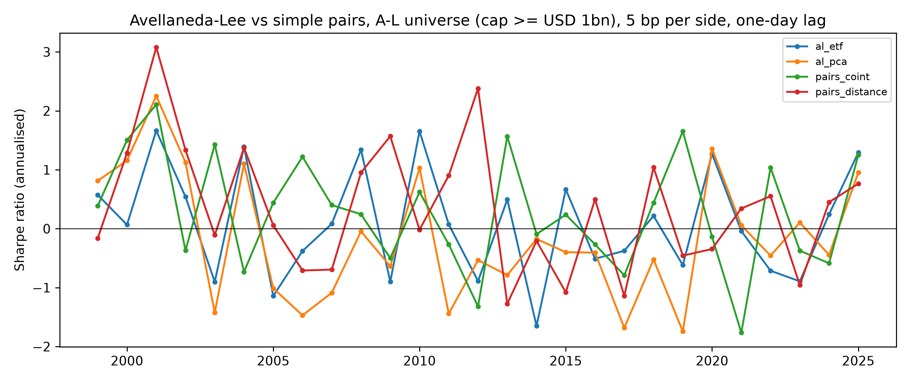
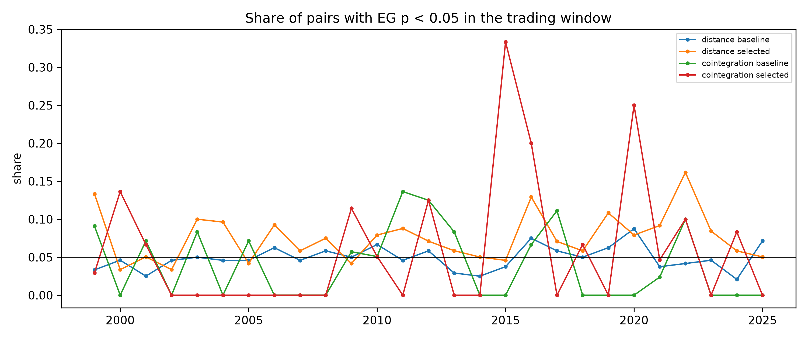
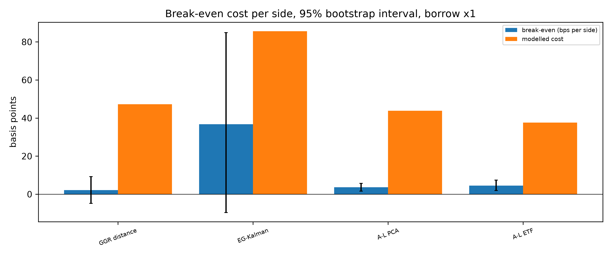
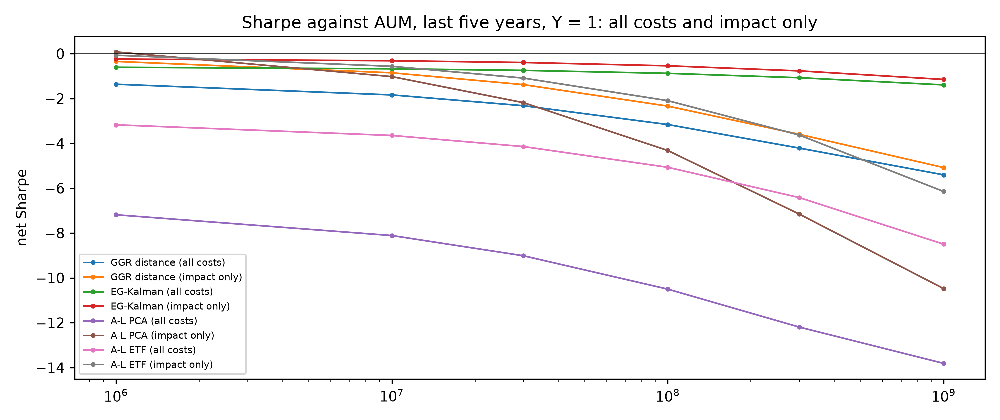

# Statistical arbitrage, done properly

[](https://github.com/avmhdt/stat-arb-pairs/actions/workflows/ci.yml)

> The classic pairs and residual-reversion trade, tested with the rigour that separates research from a tutorial. The short answer: after realistic costs, none of these strategies makes money on US stocks after 2002.

This is a research memo. Every number in it comes from a file under `results/tables/`, rebuilt by `uv run statarb report` from the runs named in `configs/study.yaml`; `results/tables/study_runs.csv` maps each name to its run. Formulas are in `docs/methodology.md`, choices in `docs/decisions.md`, data in `docs/data.md`, multiple testing in `docs/multiple_testing.md`.

## The question

Pairs trading buys the cheaper of two stocks that usually move together and shorts the dearer, betting the gap closes. Gatev, Goetzmann and Rouwenhorst (2006, "GGR") found about 1% a month on such pairs over 1962-2002, and Avellaneda and Lee (2010, "A-L") a Sharpe ratio of 1.44 for its factor-residual successor over 1997-2007. Three things decide whether either is still a trade: does the edge survive costs, do the selected relationships persist after selection, and how much capital fits before the trade moves its own prices.

## Data

The headline profile is Sharadar's survivorship-free US equity history (daily prices, delistings, point-in-time industry codes and share counts) from 1998, read through the `eqpit` package of the sibling equity-factor-pipeline project. Delisted names stay in each universe until they delist, with a return of -30% imputed for performance-related delistings (Shumway 1997). There is no CRSP, so GGR is replicated on the 1999-2002 overlap only. Sector ETF prices come from Sharadar's fund prices, the short-term reversal factor from Kenneth R. French's Data Library, and current borrow fees from an IBKR snapshot. The licence allows aggregates only, so no security-level data is in git. Data-quality checks DQ-01 to DQ-15 pass (`reports/dq/dq_report.md`).

## Method



- **Windows.** 12 months of formation, then 6 of trading, a new window every month. Nothing dated after the formation end `T` reaches selection; a test perturbs every later row and requires identical selections.
- **Selection.** *Distance* (GGR): the pairs with the smallest sum of squared differences between normalised prices. *Cointegration*: Engle-Granger on log total-return indices within two-digit SIC groups, both orderings with the larger p-value kept, Benjamini-Hochberg at q = 0.05 over every pair tested in the window, an Ornstein-Uhlenbeck half-life between 1 and 63 sessions, and Johansen confirmation.
- **Hedge and signal.** A Kalman filter (state noise delta = 1e-4) tracks the hedge ratio from formation into trading without looking ahead; its standardised innovation is the z-score. Open at |z| >= 2, close at 0, stop at 4, time stop at three half-lives.
- **Residual strategy.** A-L: each day, regress each stock's last 60 returns on 15 principal-component eigenportfolios (or its sector ETF), fit an OU process to the cumulative residual and trade its s-score.
- **Costs.** 1 bp commission, Corwin-Schultz half-spreads (2 bp floor), square-root impact capped at 10% of average daily volume, and borrow at 0.25% to 5% a year by size. Trades execute at the next close.



<!-- numbers:start -->
## Results

### GGR replication and decay

Over 1999-2002, gross of costs as in the paper, GGR's top-20 portfolio earns 1.01% a month on fully invested capital without waiting a day (paper 1.44%) and 0.70% with the wait (paper 0.90%), Newey-West t of 3.0 and 2.8 (`ggr_replication.csv`). Every cell has the paper's sign. The paper's ordering fails: pairs 101-120 earn 2.42% a month, more than the top pairs, as GGR's own 1989-2002 sub-sample also shows (`docs/findings.md`).



Run on to 2025 (gross, one-day wait, committed capital), GGR earns 0.45% a month in 1999-2002 (Sharpe 1.58), 0.19% in 2003-2009, 0.06% in 2010-2017 and 0.16% in 2018-2025 (`decay_by_period.csv`). The post-2002 mean is 0.13% a month, 95% interval 0.03% to 0.24%; the trend is negative but not significant (t -1.09, `decay_trend.csv`). That matches the direction of Do and Faff (2010): returns fell after the 1990s and held up best in turbulent markets.

### Avellaneda-Lee against simple pairs

Trading at the signal day's close at 5 bp per side, as A-L do, the PCA strategy has a Sharpe ratio of 1.42 over 1999-2007 against A-L's 1.44 (`al_vs_paper.csv`). With the one-day lag this project uses everywhere it falls to 0.51, and at the full cost model to -7.79, because it turns its capital over about 270 times a year (`al_vs_pairs.csv`). At 5 bp and the one-day lag, A-L and simple pairs cannot be told apart: every Sharpe difference has a bootstrap interval spanning zero (`al_vs_pairs_sharpe_diff.csv`).



### Do selected pairs stay cointegrated?

Barely. In the six-month trading window, 5.9% of the 421 FDR-selected pairs still reject no cointegration at 5% (Wilson 95% interval 4.1% to 8.6%), against 5.0% for matched unselected candidates and the 5% expected by chance; 6.4% do in the following 12 months. Distance pairs do slightly better, 7.6% against 4.9% (`oos_persistence.csv`). Selection on 12 months of history says little about the next six.



### Break-even cost

| Strategy, 1999-2025 | Break-even, bps per side | 95% interval | Modelled cost per side |
|---|---|---|---|
| GGR distance | 2.2 | -4.8 to 9.2 | 47 |
| EG-Kalman cointegration | 36.8 | -9.7 to 84.9 | 86 |
| A-L PCA | 3.7 | 1.7 to 5.7 | 44 |
| A-L ETF | 4.6 | 1.9 to 7.4 | 38 |

Each strategy would pay 2.3 to 22.0 times its break-even (`break_even.csv`). The break-even itself decays: GGR's is 17.0 bp in 1999-2002 and negative after 2009.



### Capacity

At the full cost model there is no capacity to measure: every strategy already loses money at zero impact over 2021-2025 (`capacity_summary.csv`). Counting impact alone, A-L PCA's Sharpe of 0.59 halves at USD 0.34m and its return reaches zero at USD 1.3m; at USD 100m, 66% of GGR's trades would exceed 10% of daily volume (`capacity.csv`). These are small-account strategies at best.



### Crowding

Correlation with the short-term reversal factor is modest: 0.27 for GGR, 0.19 for the cointegration strategy, 0.18 and 0.22 for A-L (`crowding.csv`). None lost money in the August 2007 quant unwind week; March 2020 was the bad month (GGR -3.5%, A-L PCA -6.1%). The methods trade different names: the mean yearly overlap of traded names between GGR and A-L is 0.085 (`crowding_overlap_summary.csv`).

### Trials and deflated Sharpe

The trial log holds 78 backtests: 31 distance, 29 cointegration and 9 for each A-L variant, failed, aborted and superseded runs included (`uv run statarb trials count`). No headline strategy has a positive Sharpe ratio after costs, so deflation changes no conclusion: the deflated Sharpe ratio is 0.00 for all four (`deflated_sharpe.csv`). For scale, the expected best Sharpe of 29 skill-free cointegration trials with the observed spread is 0.65.

| Family (headline run, net) | Trials | Sharpe | PSR vs 0 | DSR |
|---|---|---|---|---|
| GGR distance | 31 | -2.01 | 0.00 | 0.00 |
| EG-Kalman cointegration | 29 | -0.33 | 0.04 | 0.00 |
| A-L PCA | 9 | -7.95 | 0.00 | 0.00 |
| A-L ETF | 9 | -4.21 | 0.00 | 0.00 |

## What failed

- **The 10% ADV cap was not enforced until M6.** The cost config declared `max_participation: 0.10` from the start, but no code read it, so on thin stocks the backtest entered positions of up to several hundred times average daily volume and charged square-root impact on them; one distance-strategy day lost 74% of capital. Found while checking a -98% drawdown, fixed in both engines, and all 14 affected runs were rerun (`docs/decisions.md`). The A-L comparison barely moved. GGR at full costs now loses 4.4% a year with a Sharpe ratio of -2.01; uncapped it had lost about three times as much, with returns so volatile that its Sharpe ratio looked better. The superseded runs stay in the trial log.
- **Cointegration breaks, and the test cannot see it in time.** Closing a pair when a rolling 60-session Engle-Granger p-value exceeds 0.20 cuts the worst 5% of trade losses from -14.7% to -5.4% of the slot, but mostly by trading far less (22 trades against 190; `break_policies.csv`). Combined with the persistence result, the answer to "cointegration broke during your trading window" is: assume it will, cut the position, and size so that it does not matter.
- **The Kalman signal at the spec's delta is underdispersed.** State noise dominates the innovation variance, so z rarely reaches 2, and with few FDR discoveries the cointegration strategy trades 1.3 pairs per window against a book of 20 (`fdr_totals.csv`). Other hedges do not help: a static formation hedge trades 1,261 times for a Sharpe ratio of -1.42, and delta of 1e-5 and 1e-3 give -0.43 and -0.42 against -0.33 at the spec's 1e-4 (`kalman_delta.csv`). The spec's value stays; choosing the best of four by its backtest would be selection on the test set.
- **Engle-Granger at 252 sessions is weak.** It over-rejects independent random walks at 5% and has power of about one half against a 10-day half-life (`tests/validation/test_cointegration.py`, strict expected failures); FDR then leaves 1,012 discoveries among 7,136,840 tests (`fdr_totals.csv`). Accepted as findings, thresholds unchanged.
- **Half-life sizing does not rescue the trade.** Inverse-half-life and volatility-target sizing leave GGR's Sharpe ratio at -2.01 and -2.10, against -2.01 for equal gross (`sizing_half_life.csv`). The theory holds (capital per unit of expected P&L scales with the half-life), but the selected cointegrated pairs nearly all have half-lives under 5 sessions.
- **A Windows sign-out killed one run mid-sweep.** It left no output and is logged as aborted; run folders now count only once `metrics.json` is written last.

<!-- numbers:end -->
## Limitations

History starts in 1998, so 1962-1998 and most of GGR's sample are missing. Delisting returns are imputed, not observed. Spreads come from daily highs and lows, not quotes. Borrow is an assumed schedule checked against one 2026 snapshot, which shows a heavy tail of hard-to-borrow names the schedule misses. Industry groups are SIC2 only. Impact uses one coefficient (Y = 1, with 0.5 and 2 as sensitivities). The A-L universe and sizing follow the paper but were not tuned. No intraday or crypto variant was built.

## Questions this project answers

- **Cointegration broke during your trading window. What do you do?** Close it: see "What failed" and `break_policies.csv`.
- **Why does half-life matter for position sizing?** Expected P&L arrives over about one half-life, so capital per unit of P&L scales with it; `docs/methodology.md` section 3 and `sizing_half_life.csv`.
- **How is this different from what every quant ran in 2007?** It is the same trade, measured after the fact: decay, costs, capacity and crowding above.
- **Why FDR rather than Bonferroni or raw p < 0.05, and is BH valid when pairs share a leg?** `docs/multiple_testing.md`.
- **How do you prove no look-ahead?** `tests/integration/test_no_lookahead.py` and `src/statarb/windows.py`.
- **Distance against cointegration: when does each fail?** Distance fails on costs (it turns its capital over about 10 times a year), cointegration on persistence and on finding enough pairs.
- **How did you choose delta, and why not rolling OLS?** `docs/methodology.md` section 4 and `kalman_delta.csv`.
- **How much capital could this run?** Well under USD 10m; `capacity.csv`.
- **How many backtests, and what is the deflated Sharpe?** `uv run statarb trials count` and `deflated_sharpe.csv`.

## How to reproduce

```bash
uv sync
uv run statarb smoke
uv run statarb reproduce --profile headline
uv run statarb report
uv run statarb run --config configs/ggr_distance.yaml
uv run statarb reproduce --profile prototype
```

`reproduce` ingests (a second run downloads nothing), builds, runs the DQ checks, runs every study run and the report; `--reuse` skips runs already complete for the same data. The headline profile needs `SHARADAR_API_KEY` in `.env`; the prototype profile uses a local Stooq snapshot, is survivorship-biased and is labelled prototype in every output.

### Benchmarks

On an Intel Core i9-14900K (32 logical CPUs), 128 GB RAM, Windows 11, data on a SATA hard disk, with other recorders running (`docs/hardware.md`, `reports/benchmarks.json`, `reports/run_times.csv`):

| Task | Target | Measured |
|---|---|---|
| Distance SSD, 1,000 stocks, one formation window | < 5 s | 0.03 s |
| Engle-Granger, 20,000 pairs both ways, one process | < 60 s | 1.26 s |
| GGR distance, 1998-2025, 319 windows, 3 workers | < 2 h | 14.7 min |
| Cointegration headline, 319 windows, 3 workers | | 3.3 min |
| `statarb reproduce --profile headline`, 28 runs | | 2 h 1 min |

## Requirements and success criteria

- [x] Formation and trading windows kept strictly apart (12 months formation, 6 months trading, rolling). FR-02, FR-03, AC-W-01
- [x] Pair selection by distance and by cointegration (Engle-Granger, Johansen), with false-discovery-rate control. FR-08 to FR-11, AC-W-03, AC-W-04
- [x] Kalman-filter hedge ratios, an Ornstein-Uhlenbeck fit and half-life, and z-score entry, exit and stop rules. FR-12 to FR-14, AC-W-06, AC-W-07
- [x] A step up to residual stat arb using PCA or ETF-factor residuals (Avellaneda and Lee 2010). FR-18, AC-W-14
- [x] Costs: commissions, spread and short-borrow fees. FR-16, AC-W-08
- [x] A test shows no information from the trading window leaks into pair selection. AC-W-01, AC-W-02
- [x] Multiple-testing control on cointegration p-values is documented. FR-30, AC-W-03
- [x] A replication of Gatev, Goetzmann and Rouwenhorst (2006) showing how returns have decayed since. FR-20, FR-21, AC-H-01, AC-H-02
- [x] A replication of Avellaneda-Lee compared with simple pairs. FR-18, FR-19, AC-H-03
- [x] The share of pairs that stay cointegrated out of sample, and the break-even transaction cost. FR-22, FR-23, AC-H-04, AC-H-05
- [x] A capacity and crowding discussion backed by numbers. FR-24, FR-25, AC-H-06, AC-H-07
